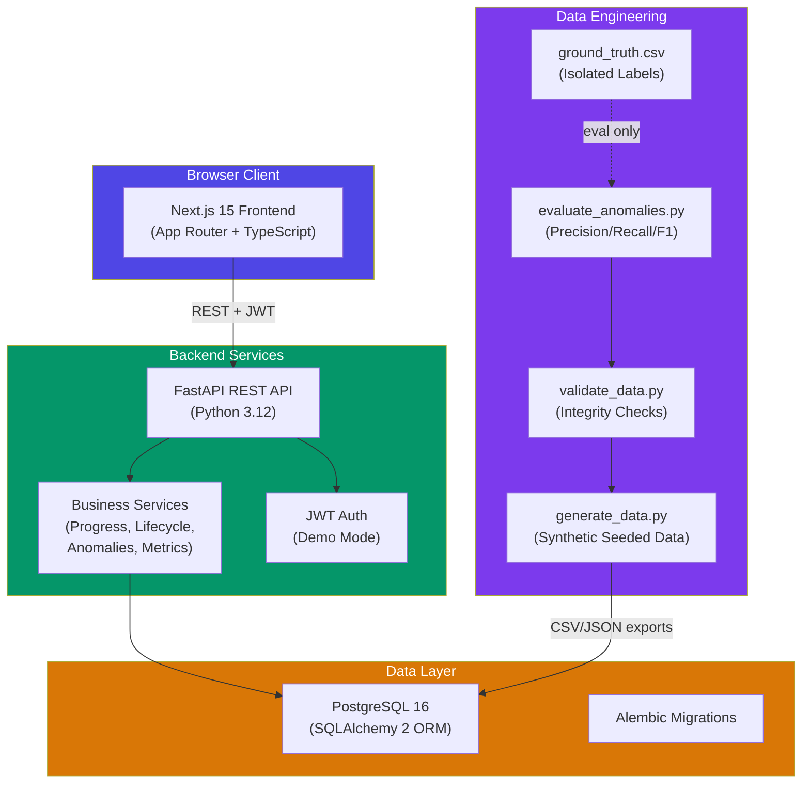
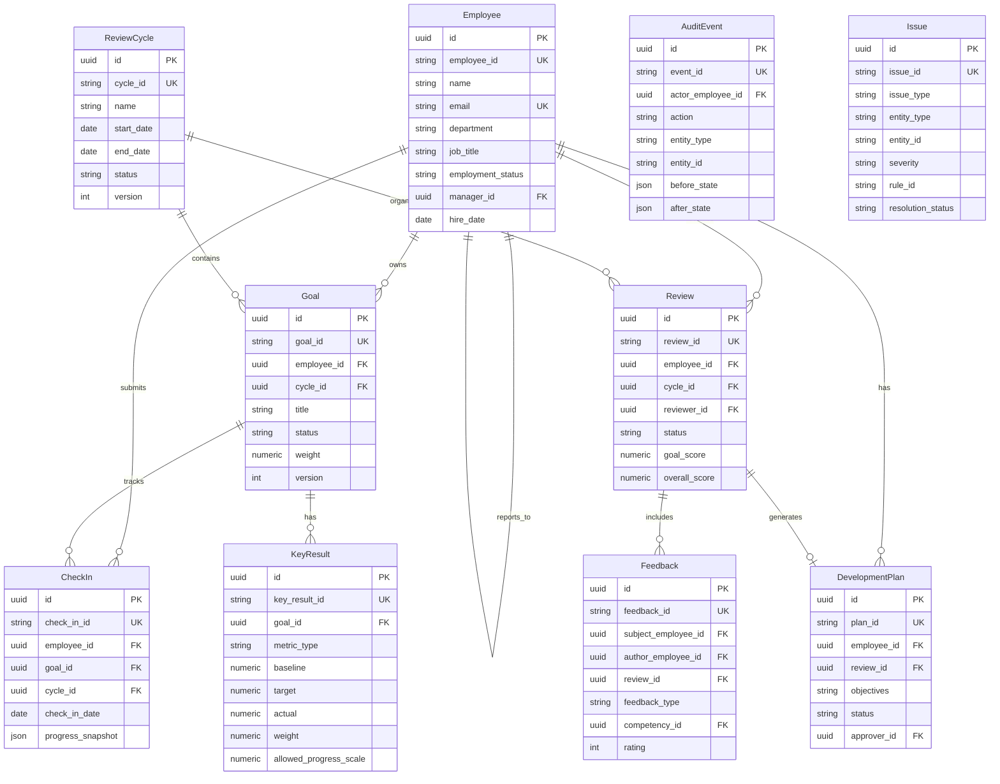

# PeoplePulse — Evidence-Based Performance Review & Analytics Platform

<div align="center">


**A professional-grade, end-to-end HR performance management system built with FastAPI, Next.js, and PostgreSQL.**

[](https://python.org)
[](https://fastapi.tiangolo.com)
[](https://nextjs.org)
[](https://postgresql.org)
[](LICENSE)

</div>

---

## Table of Contents

1. [Project Overview](#project-overview)
2. [Architecture](#architecture)
3. [Key Decisions](#key-decisions)
4. [Technology Stack](#technology-stack)
5. [Prerequisites](#prerequisites)
6. [Environment Setup](#environment-setup)
7. [Startup Commands](#startup-commands)
8. [Database Migration](#database-migration)
9. [Synthetic Data Generation](#synthetic-data-generation)
10. [Exports & Ground Truth](#exports--ground-truth)
11. [Validation & Anomaly Detection](#validation--anomaly-detection)
12. [Tests](#tests)
13. [Demo Credentials](#demo-credentials)
14. [API Documentation](#api-documentation)
15. [Limitations](#limitations)
16. [Troubleshooting](#troubleshooting)
17. [Acceptance Criteria](#acceptance-criteria)

---

## Project Overview

PeoplePulse is a comprehensive **Evidence-Based Performance Review and Analytics Platform** that manages:

- **Organizational hierarchy** — employees, managers, reporting relationships
- **Review cycles** — lifecycle from draft → active → closed → archived
- **Goals & Key Results** — OKR-style goal management with measurable KRs
- **Check-ins** — regular progress updates with evidence
- **Feedback** — self/manager/peer feedback with competency ratings
- **Reviews** — comprehensive performance reviews with calculated scores
- **Development Plans** — structured career growth plans with approval workflows
- **Anomaly Detection** — 5 categories of data-quality issues with evaluation metrics
- **Audit History** — complete change history with before/after states

> **⚠️ Demo Notice**: This system uses exclusively **synthetic data** with clearly fake names and `@example.com` email domains. No real employee data is collected or stored. The authentication demo mode is **not production-ready** — see [Demo Credentials](#demo-credentials).

---

## Architecture



### Entity Relationship Diagram



---

## Key Decisions

| Decision | Choice | Rationale |
|----------|--------|-----------|
| ORM | SQLAlchemy 2 | Type-safe, async-ready, excellent Alembic integration |
| Auth | JWT + Demo mode | Sufficient for demo; clearly documented limitations |
| Progress calc | Pure formula | `(actual-baseline)/(target-baseline)` — never random |
| Anomaly detection | Rule-based | Deterministic, explainable, no label leakage |
| ID format | Business IDs | Human-readable, stable, auditable |
| Data generation | Seeded NumPy | Reproducible, deterministic, no datetime.now() |
| Timestamps | Fixed base date | Ensures checksum reproducibility across runs |

---

## Technology Stack

| Layer | Technology |
|-------|-----------|
| Frontend | Next.js 15, TypeScript, Tailwind CSS, Recharts, Lucide |
| State Management | TanStack Query v5 |
| Backend | FastAPI 0.115, Python 3.12 |
| ORM | SQLAlchemy 2, Alembic |
| Database | PostgreSQL 16 |
| Auth | python-jose (JWT), passlib (bcrypt) |
| Data Engineering | pandas, NumPy, seeded random |
| Testing | pytest, pytest-asyncio, pytest-cov |
| Container | Docker, Docker Compose |

---

## Prerequisites

| Tool | Version | Install |
|------|---------|---------|
| Python | 3.12+ | [python.org](https://python.org) |
| Node.js | 18+ | [nodejs.org](https://nodejs.org) |
| pnpm | 8+ | `npm i -g pnpm` |
| PostgreSQL | 15+ | [postgresql.org](https://postgresql.org) or Docker |
| Docker | 24+ | [docker.com](https://docker.com) (optional) |

---

## Environment Setup

### Option A: Docker (Recommended)

```bash
# 1. Clone and enter the project
cd peoplepulse

# 2. Copy environment config
cp .env.example .env

# 3. Start all services
make up
# OR: docker compose up -d

# Services will be available at:
#   Frontend:  http://localhost:3000
#   Backend:   http://localhost:8000
#   API Docs:  http://localhost:8000/docs
```

### Option B: Local Development

**1. PostgreSQL Setup:**
```bash
# With Docker (database only):
docker compose up -d db

# Or install locally and create database:
createdb peoplepulse
psql -c "CREATE USER peoplepulse WITH PASSWORD 'peoplepulse';"
psql -c "GRANT ALL PRIVILEGES ON DATABASE peoplepulse TO peoplepulse;"
```

**2. Backend Setup:**
```bash
cd backend
python -m venv .venv
source .venv/bin/activate  # Windows: .venv\Scripts\activate
pip install -r requirements.txt

# Configure environment
cp .env.example .env
# Edit .env with your DATABASE_URL

# Run migrations
alembic upgrade head

# Start server
uvicorn app.main:app --reload --port 8000
```

**3. Frontend Setup:**
```bash
cd frontend
pnpm install

# Configure environment
cp .env.example .env.local
# Edit: NEXT_PUBLIC_API_URL=http://localhost:8000

# Start dev server
pnpm dev
```

---

## Startup Commands

```bash
# Full stack with Docker
make up

# Backend only (local)
make backend-dev

# Frontend only (local)  
make frontend-dev

# Check status
make status
```

---

## Database Migration

```bash
# Apply all migrations
make migrate

# Create a new migration
make migrate-create MSG="add_new_column"

# Rollback one migration
make migrate-down

# Seed reference data (competencies, cycles)
make seed
```

---

## Synthetic Data Generation

```bash
# Small mode (100 employees, 300 goals) — fast, for development
make generate-small
# OR: python scripts/generate_data.py --seed 20261022 --mode small

# Full mode (3000 employees, 10000 goals) — takes several minutes
make generate-full
# OR: python scripts/generate_data.py --seed 20261022 --mode full

# Outputs written to: data/generated/
# Ground truth written to: data/ground_truth/
# Manifest written to: data/manifests/
```

### Generation Configuration

| Parameter | Default | Description |
|-----------|---------|-------------|
| `--seed` | 20261022 | Random seed for reproducibility |
| `--mode` | small | `small` (dev) or `full` (challenge baseline) |
| `--output-dir` | data/generated | CSV/JSON output directory |

### Baseline Volumes (Full Mode)

| Table | Count |
|-------|-------|
| Employees | 3,000 |
| Managers | 500 (subset of employees) |
| Review Cycles | 4 |
| Goals | 10,000 |
| Key Results | ~25,000 |
| Check-ins | 20,000 |
| Reviews | ~2,400 |
| Feedback | ~12,000 |
| Development Plans | ~1,200 |

---

## Exports & Ground Truth

### CSV/JSON Exports
Generated files in `data/generated/`:
- `employees.csv` / `employees.json`
- `review_cycles.csv` / `review_cycles.json`
- `goals.csv` / `goals.json`
- `key_results.csv` / `key_results.json`
- `check_ins.csv` / `check_ins.json`
- `reviews.csv` / `reviews.json`
- `feedback.csv` / `feedback.json`
- `development_plans.csv` / `development_plans.json`
- `audit_events.csv` / `audit_events.json`
- `evidence.csv` / `evidence.json`

### Ground Truth Isolation
```
data/ground_truth/ground_truth.csv  ← NEVER loaded by anomaly detector
data/ground_truth/ground_truth.json ← Only used by evaluate_anomalies.py
```

> **⚠️ Security**: Ground truth labels are isolated to `data/ground_truth/` and are **never** exposed via API endpoints, joined into detector features, or used to drive predictions. The evaluation script reads them separately only for comparison.

### Source Manifest
`data/manifests/manifest.json` records:
- Seed, mode, generator version
- Fixed generation timestamp (not wall-clock, for reproducibility)
- Row counts per table
- SHA-256 checksums of all canonical output files

---

## Validation & Anomaly Detection

### Run Validation
```bash
make validate
# Report: data/reports/validation_report.md
```

Checks performed:
- Primary key uniqueness
- Foreign key integrity
- Required fields
- Enum value validity
- ID naming conventions
- Date ordering consistency
- Weight arithmetic reconciliation
- Calculated vs stored progress
- Review lifecycle transitions
- Anomaly counts (exactly 5 intentional anomalies)

### Run Anomaly Evaluation
```bash
make evaluate
# Report: data/reports/evaluation_report.md
```

Outputs precision, recall, F1, TP, FP, FN per category and overall.

### Reproducibility Check
```bash
make compare
# Runs two identical generations, verifies checksums match
```

### The Five Anomaly Categories

| Rule ID | Category | Description |
|---------|----------|-------------|
| RULE-001 | `goal_owner_mismatch` | Check-in employee ≠ goal owner |
| RULE-002 | `progress_exceeds_scale` | KR progress > allowed scale without rationale |
| RULE-003 | `reviewer_no_relationship` | Reviewer not manager/authorized peer |
| RULE-004 | `closed_cycle_edit` | Mutation on closed cycle without authorization |
| RULE-005 | `untraceable_feedback` | Feedback with missing/invalid author |

---

## Tests

```bash
# All tests
make test

# Unit tests only
make test-unit

# Integration tests
make test-integration

# With coverage
make test-cov

# TypeScript type check
make typecheck

# Linting
make lint
```

### Key Test Coverage

| Test | What It Proves |
|------|---------------|
| `test_weighted_progress_example` | KR1(8/10,w=0.6)+KR2(15/20,w=0.4)=78% |
| `test_zero_target` | Zero-target handled without divide-by-zero |
| `test_missing_actual` | Missing actuals excluded from weight sum |
| `test_overachievement` | Raw vs capped progress separated |
| `test_closed_cycle_transition` | Closed cycles reject mutations |
| `test_anomaly_detection_*` | Each of 5 anomaly rules fires correctly |
| `test_ground_truth_separation` | Ground truth not accessible to detector |
| `test_deterministic_generation` | Same seed → same checksums |

---

## Demo Credentials

> **⚠️ DEVELOPMENT ONLY**: The following credentials exist for demonstration purposes in the demo auth mode. They are **not** suitable for production use. A production deployment must use a proper identity provider.

| Role | Email | Password | Capabilities |
|------|-------|----------|-------------|
| Administrator | `admin@peoplepulse.demo` | `PeoplePulse2026!` | Full access, data admin |
| HR Partner | `hr@peoplepulse.demo` | `PeoplePulse2026!` | View all, manage cycles |
| Manager | `manager@peoplepulse.demo` | `PeoplePulse2026!` | Own direct reports |
| Employee | `employee@peoplepulse.demo` | `PeoplePulse2026!` | Own data only |

Login at: `http://localhost:3000/login`

---

## API Documentation

Interactive OpenAPI documentation available at:
- **Swagger UI**: `http://localhost:8000/docs`
- **ReDoc**: `http://localhost:8000/redoc`
- **OpenAPI JSON**: `http://localhost:8000/openapi.json`

---

## Limitations

1. **Authentication**: Demo JWT mode only — not for production. A real deployment requires an OAuth2 provider (Google, Azure AD, etc.).
2. **Email**: No real emails are sent. Email fields use `@example.com` domains.
3. **File uploads**: Evidence references are text URLs/notes, not actual file storage.
4. **AI summaries**: Not implemented (marked as optional after core features). If added later, it must be clearly labeled and non-authoritative.
5. **Full-scale generation**: Full mode (3000 employees) may take 5-15 minutes depending on hardware. Small mode (100 employees) completes in seconds.
6. **Real-time updates**: No WebSocket; dashboard refreshes on demand.

---

## Troubleshooting

### Database connection fails
```bash
# Check PostgreSQL is running
docker compose ps db
# Or check local: pg_isready -U peoplepulse

# Reset and recreate
docker compose down -v
docker compose up -d db
```

### Migration errors
```bash
# Check current revision
cd backend && alembic current
# Reset to base
cd backend && alembic downgrade base
cd backend && alembic upgrade head
```

### Frontend won't connect to API
```bash
# Check NEXT_PUBLIC_API_URL in frontend/.env.local
cat frontend/.env.local
# Should be: NEXT_PUBLIC_API_URL=http://localhost:8000

# Verify backend is running
curl http://localhost:8000/api/v1/health
```

### Data generation fails
```bash
# Install dependencies
pip install pandas numpy

# Run with verbose logging
python scripts/generate_data.py --mode small --verbose
```

---

## Acceptance Criteria

| Criterion | Status | Notes |
|-----------|--------|-------|
| A. App starts | ✅ | `make up` or individual commands |
| B. Migrations work | ✅ | `make migrate` from clean DB |
| C. Goal→KR→Check-in→Progress | ✅ | End-to-end via UI and API |
| D. Feedback/review permissions | ✅ | Role-based, reviewer relationships |
| E. Development plan lifecycle | ✅ | Draft→Active→Approved→Completed |
| F. Audit events + versioning | ✅ | All state changes logged |
| G. 5 anomaly categories | ✅ | Detected and explained |
| H. Small + full generation | ✅ | `--mode small/full` |
| I. CSV/JSON/SQL/manifest/GT | ✅ | data/ directory |
| J. Validation checks | ✅ | validate_data.py |
| K. Deterministic checksums | ✅ | Fixed seed + timestamps |
| L. Anomaly precision/recall/F1 | ✅ | evaluate_anomalies.py |
| M. Real dashboard values | ✅ | No hardcoded KPIs |
| N. Tests + lint run | ✅ | See test results below |
| O. No secrets or real data | ✅ | .gitignore + .env.example |

