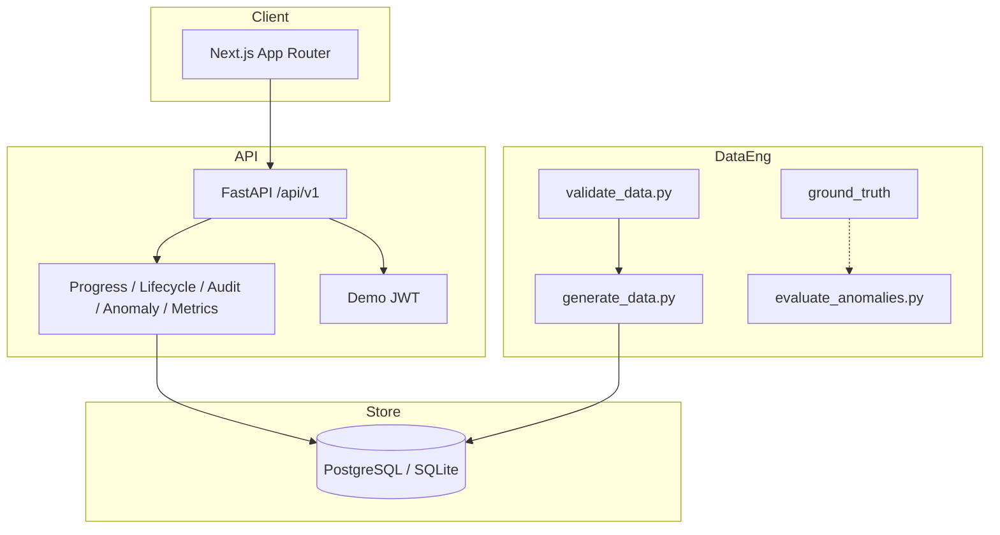

# PeoplePulse Architecture

## Overview

PeoplePulse is a three-layer system: a Next.js App Router client, a FastAPI domain API, and PostgreSQL (SQLite fallback for local demos). Synthetic data, validation, and anomaly evaluation live outside the request path so detectors cannot see ground-truth labels.

## Runtime

- Frontend calls `NEXT_PUBLIC_API_URL` through a typed client (`frontend/src/lib/api.ts`).
- Backend uses SQLAlchemy 2, Alembic, and Pydantic v2 schemas.
- Demo JWT is development-only. Production must replace `DEMO_USERS`.
- Admin generation jobs run as FastAPI background tasks and are polled by job id.

## Persistence

Internal primary keys are UUID strings. Business IDs (`EMP-000001`, `GOAL-EMP-000001-001`, …) are unique and used in APIs and exports. Foreign keys reference internal IDs.

## Data engineering isolation

Operational CSVs/JSON live in `data/generated/`. Labels live only in `data/ground_truth/` and are consumed exclusively by `scripts/evaluate_anomalies.py`.
